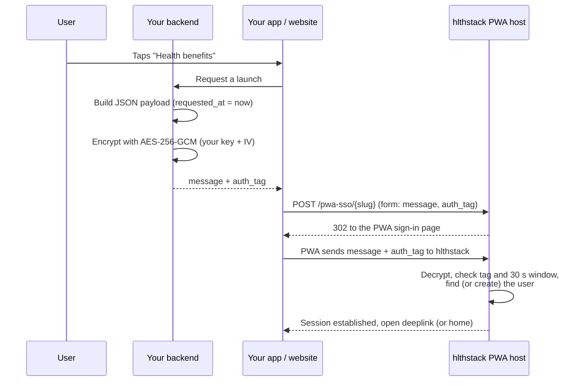

# hlthstack PWA integration guide

Embed the hlthstack web app inside your own app or website and sign your users in with single sign-on (SSO).

The hlthstack PWA is a progressive web app that gives your users their health benefits: annual health checkups, lab tests, doctor consultations, pharmacy, mental wellness, dental and vision care, vaccinations and more. You can open it in a WebView inside your Android or iOS app, or in a browser tab from your website. Your users never see a login screen: your backend vouches for them with an encrypted, short-lived payload.

For the REST API (bookings, benefits, webhooks and so on) see the [hlthstack integration guide](https://github.com/hlthstack/integration-guide). For hlthstack itself, see [hlthstack.io](https://www.hlthstack.io/).

## Contents

- [How SSO works](#how-sso-works)
- [What hlthstack gives you](#what-hlthstack-gives-you)
- [Environments](#environments)
- [Payload](#payload)
- [Encrypting the payload](#encrypting-the-payload)
- [Launching the PWA](#launching-the-pwa)
- [Errors](#errors)
- [Embedding tips](#embedding-tips)
- [Security notes](#security-notes)
- [Examples](#examples)

## How SSO works



1. **Your backend builds the payload**: a small JSON object identifying the user (see [Payload](#payload)), stamped with the current time.
2. **Your backend encrypts it** with AES-256-GCM, using the key and IV that hlthstack issues for each environment. The result is two strings, `message` and `auth_tag`.
3. **Your app or website sends the user to** `https://pwa.hlthstack.io/pwa-sso/<slug>` with an HTTP `POST` carrying `message` and `auth_tag` as form fields.
4. **hlthstack replies with a `302` redirect** into the PWA's sign-in page. That page passes `message` and `auth_tag` to the hlthstack backend, which decrypts and validates them, finds or creates the user, and starts the session.
5. **The PWA opens** the page named by `deeplink`, or its home page.

The whole trip, from the moment you set `requested_at` until the PWA's sign-in page reaches the backend, must take **less than 30 seconds**. Encrypt just before launching. Never pre-generate, cache or reuse a payload.

## What hlthstack gives you

hlthstack issues these per environment. Staging and production values are different.

| Item | Used where | Notes |
|---|---|---|
| `slug` | Launch URL path | Identifies you as an integration partner. |
| `entity_id` | Payload | Identifies the employer, group or programme the user belongs to. You may get more than one; each must be registered under your `slug`. |
| `encoded_key` | Encryption | Base64. Decodes to a 32-byte AES-256 key. |
| `encoded_iv` | Encryption | Base64. Decodes to the GCM IV (nonce). Use it exactly as issued. |

Treat `encoded_key` and `encoded_iv` as secrets (see [Security notes](#security-notes)).

## Environments

| Environment | PWA host | Launch URL |
|---|---|---|
| Staging | `https://staging-pwa.hlthstack.io` | `https://staging-pwa.hlthstack.io/pwa-sso/<slug>` |
| Production | `https://pwa.hlthstack.io` | `https://pwa.hlthstack.io/pwa-sso/<slug>` |

Integrate and test against staging first, with your staging `slug`, `entity_id`, key and IV. Switch all four together when you move to production.

## Payload

The payload is a JSON object, serialised to a UTF-8 string and then encrypted. Field names are case-sensitive.

| Field | Required | Type | Description |
|---|---|---|---|
| `entity_id` | Yes | string or integer | Issued by hlthstack. Must belong to the `slug` you launch with. |
| `requested_at` | Yes | integer | Current Unix time in **seconds** (not milliseconds). The request is rejected once 30 seconds have passed. |
| `email` | Yes (see note) | string | The user's email. Lowercased and trimmed. This is how hlthstack finds the user within the entity. |
| `member_id` | Depends on your setup | string | Your unique identifier for the user, such as an employee code. Stored as the user's employee ID; used to match pre-registered users (see below). |
| `first_name` | Yes for new users | string | Used when the user is created. |
| `last_name` | No | string | Used when the user is created. |
| `gender` | No | string | `M`, `F`, `Male` or `Female` (any case). Any other value is ignored. |
| `dob` | No | string | Date of birth. Use `YYYY-MM-DD`; `DD-MM-YYYY` and `DD/MM/YYYY` are also accepted. A value that cannot be parsed is ignored. |
| `mobile` | No | string | Mobile number. Stored as an alternate contact number; not used to find or sign in the user. |
| `grade` | No | string | Employee grade. |
| `department` | No | string | Employee department. |
| `voluntary_plan_ids` | No | array | Plans to enrol the user in. See [Plans](#plans). |
| `selected_plan` | No | string | The plan ID of one of the user's active plans to open the session against. Must be a string. |
| `deeplink` | No | string | The page to open after sign-in. See [Deeplinks](#deeplinks). Defaults to the home page. |

**How the user is matched.** hlthstack looks for the user by `email` within the entity:

- **Standard entities.** If no user with that email exists, one is created from the payload (`first_name`, `last_name`, `member_id`, `gender`, `dob`, `mobile`, `grade`, `department`). Profile fields are only used at creation; sending different values on later launches does not change an existing user.
- **Pre-registration-only entities.** Some entities are set up so that users are registered in advance (for example through the REST API) and SSO never creates anyone. The user is matched by `email`, or, if that finds no one, by `member_id` (case-insensitive, compared with the employee ID given at registration). Only `entity_id`, `requested_at` and `email` or `member_id` are needed. If no active registered user matches, sign-in fails with "Customer is not registered" (see [Errors](#errors)). hlthstack tells you whether your entity works this way.

Example:

```json
{
  "entity_id": "1234",
  "member_id": "EMP-0001",
  "email": "jane.doe@example.com",
  "first_name": "Jane",
  "last_name": "Doe",
  "gender": "F",
  "dob": "1990-08-15",
  "mobile": "9000000000",
  "grade": "A",
  "department": "Engineering",
  "deeplink": "new-benefits/ahc",
  "requested_at": 1794285072
}
```

### Plans

Each entry of `voluntary_plan_ids` is either a plan ID string, or an object:

```json
{
  "voluntary_plan_ids": [
    "plan_1",
    { "plan_id": "plan_2", "start_date": "2026-01-01", "additional": true, "subscription_id": "SUB-42" }
  ]
}
```

| Key | Description |
|---|---|
| `plan_id` | Plan ID issued by hlthstack. |
| `start_date` | Optional. Enrolment start date, `YYYY-MM-DD`. |
| `additional` | Optional. `true` to add a second enrolment in a plan the user already holds. Only honoured together with `subscription_id`. |
| `subscription_id` | Optional. Your identifier for this subscription. The payload is sent on every launch; with a `subscription_id` a repeated entry reuses the same enrolment instead of creating another. |

### Deeplinks

Set `deeplink` to one of these values to open a specific page. Any other value opens the home page.

| Page | `deeplink` |
|---|---|
| Benefits | `benefits` |
| Annual health check | `new-benefits/ahc` |
| Lab tests | `lab-tests` |
| Lab tests / health checks | `benefits/health-checks` |
| All consultations | `benefits/consultations` |
| 24x7 GP consultation | `benefits/consultation24x7` |
| Online specialist consultation | `benefits/spc` |
| Dietician consultation | `benefits/spc/dietician-consultation` |
| In-clinic specialist consultation | `benefits/inclinic` |
| Consultations | `consultations` |
| Consultation history | `consultations-history` |
| Pharmacy | `benefits/pharmacy` |
| Prescriptions | `medications` |
| Mental wellness | `benefits/ewap` |
| Dental | `new-benefits/dental` |
| Vision | `new-benefits/vision` |
| Vaccination | `new-benefits/flu_vaccination` |
| Gyms | `benefits/gyms` |
| Health coach programme | `benefit-modes/health_coach_program` |
| Health section | `health` |
| Medical reports | `medical-reports` |
| Personal health profile | `personal-health-profile` |
| Health risk assessment | `health-risk-assessment` |
| Health risk assessment insights | `health-risk-assessment/insights` |
| Improve | `improve` |
| Challenges | `improve/challenges` |
| Challenge leaderboard | `improve/challenges/leaderboard` |
| Events | `events` |
| Rewards | `rewards` |
| Booking history | `booking-history` |
| One booking | `booking-history?orderId=<order-id>` |
| Family members | `family-members` |
| Wallet | `wallet` |
| Service utilisation | `contract/service-utilization` |
| A form | `form?id=<form-id>&benefit_id=<benefit-id>` |

For `booking-history?orderId=<order-id>`, use the order ID hlthstack returned when the booking was made. The PWA opens the matching appointment, pharmacy order or gym booking; an unknown ID opens the home page.

## Encrypting the payload

| Parameter | Value |
|---|---|
| Algorithm | AES-256-GCM |
| Key | `encoded_key`, Base64-decoded (32 bytes) |
| IV / nonce | `encoded_iv`, Base64-decoded, used as issued |
| Additional authenticated data | none |
| Auth tag length | 16 bytes (128 bits), the default in every common library |
| Plaintext | the payload JSON as a UTF-8 string |
| `message` | ciphertext, **URL-safe** Base64 (`-` and `_` instead of `+` and `/`), with `=` padding |
| `auth_tag` | the GCM tag, URL-safe Base64 with `=` padding |

Steps:

1. Set `requested_at` to the current Unix time in seconds and serialise the payload to JSON.
2. Base64-decode `encoded_key` and `encoded_iv`.
3. Encrypt the JSON with AES-256-GCM and that key and IV, with no additional authenticated data.
4. URL-safe Base64-encode the ciphertext: that is `message`.
5. URL-safe Base64-encode the 16-byte tag: that is `auth_tag`. (Some libraries, such as Python `cryptography` and Java, return the tag appended to the ciphertext; split off the last 16 bytes.)

In Ruby:

```ruby
cipher = OpenSSL::Cipher.new('aes-256-gcm')
cipher.encrypt
cipher.key = Base64.decode64(encoded_key)
cipher.iv  = Base64.decode64(encoded_iv)
ciphertext = cipher.update(payload_json) + cipher.final

message  = Base64.urlsafe_encode64(ciphertext)
auth_tag = Base64.urlsafe_encode64(cipher.auth_tag)
```

Complete Node.js, Python, Ruby and Java versions are in [`examples/`](examples).

## Launching the PWA

```
POST https://pwa.hlthstack.io/pwa-sso/<slug>
Content-Type: application/x-www-form-urlencoded

message=<message>&auth_tag=<auth_tag>
```

The request must be a top-level navigation (the user's browser or WebView loads it), not a background `fetch` or server-to-server call, because the `302` response has to take the user into the PWA. URL-encode both values in the form body as you would any form field. The launch endpoint only accepts `POST`.

### From a website

Have your backend render a page that posts itself:

```html
<form id="hlthstack-sso" method="post" action="https://pwa.hlthstack.io/pwa-sso/your-partner-slug">
  <input type="hidden" name="message" value="MESSAGE_FROM_YOUR_BACKEND">
  <input type="hidden" name="auth_tag" value="AUTH_TAG_FROM_YOUR_BACKEND">
</form>
<script>document.getElementById('hlthstack-sso').submit();</script>
```

Add `target="_blank"` to the form to open hlthstack in a new tab.

### From an Android WebView

```kotlin
val body = "message=" + URLEncoder.encode(message, "UTF-8") +
           "&auth_tag=" + URLEncoder.encode(authTag, "UTF-8")
webView.postUrl("https://pwa.hlthstack.io/pwa-sso/your-partner-slug", body.toByteArray())
```

### From an iOS WKWebView

```swift
var request = URLRequest(url: URL(string: "https://pwa.hlthstack.io/pwa-sso/your-partner-slug")!)
request.httpMethod = "POST"
request.setValue("application/x-www-form-urlencoded", forHTTPHeaderField: "Content-Type")
var form = URLComponents()
form.queryItems = [URLQueryItem(name: "message", value: message),
                   URLQueryItem(name: "auth_tag", value: authTag)]
request.httpBody = form.percentEncodedQuery?
    .replacingOccurrences(of: "+", with: "%2B")
    .data(using: .utf8)
webView.load(request)
```

In all three cases `message` and `auth_tag` come from your backend, fetched just before launch.

## Errors

The launch endpoint always answers with the `302` redirect. Validation happens when the PWA's sign-in page sends the payload on to the hlthstack backend, so failures are shown to the user on that page, together with a **Try again** button. Your server does not receive the error. Use staging to test each case below.

| Cause | Message shown |
|---|---|
| `message` or `auth_tag` missing | Missing params for requested resource |
| Unknown `slug`, or no entity set up for it yet | Requested resource cannot be found |
| Decryption failed: wrong key or IV, wrong environment, `message` or `auth_tag` altered or truncated (for example a `+` sent unencoded in the form body), or the plaintext is not valid JSON | Unable to process the login request, please contact your HR. |
| `requested_at` missing, or more than 30 seconds old when the PWA reached the backend | Request expired. Please try again |
| `entity_id` unknown, or registered under a different `slug` | Entity is not registered … Please contact support team |
| Pre-registration-only entity and no active registered user matches `email` or `member_id` | Customer is not registered … Please contact partner |
| The user could not be created (for example, invalid data) | The validation message |
| `selected_plan` is not a string | selected_plan must be a string |
| `selected_plan` is not one of the user's active plans | Selected plan not found |
| Anything else | Something went wrong |

**Try again** resends the same payload, so it only helps within the 30-second window. After an expiry, send the user back through your launch flow to get a fresh payload.

## Embedding tips

The PWA is a regular web app; it needs no SDK or JavaScript bridge from you. These settings let all of its features work inside a WebView.

**Both platforms**

- Enable JavaScript and DOM storage (`localStorage`). The session is kept in web storage and cookies; without them the user is signed out on every page load.
- Allow cookies for the hlthstack hosts, including cross-site cookies: the PWA talks to the hlthstack API on a different host with credentials.
- Launch through SSO each time the user opens the embed. When a user signs out of your app, clear the WebView's cookies and web storage so the next person on the device does not inherit the session.
- Hand non-web links to the operating system: `tel:`, `mailto:`, `upi:`, `intent:` and WhatsApp links are used for calls, email, UPI payments and support.

**Android WebView**

- `settings.javaScriptEnabled = true`, `settings.domStorageEnabled = true`, and `CookieManager.getInstance().setAcceptThirdPartyCookies(webView, true)`.
- Camera and microphone are used for video consultations, voice input and QR scanning. Request `CAMERA` and `RECORD_AUDIO` at runtime and grant them in `WebChromeClient.onPermissionRequest`.
- File upload (prescriptions, reports, photos, including camera capture) needs `WebChromeClient.onShowFileChooser`.
- Location is used for addresses and nearby providers: implement `onGeolocationPermissionsShowPrompt` and request location permission.
- Links that open a new window (`target="_blank"`, `window.open`), such as external sites and documents, need `setSupportMultipleWindows(true)` with `onCreateWindow`, or open them in a Custom Tab. Route non-http(s) schemes to an `Intent` in `shouldOverrideUrlLoading`.
- Some documents are downloaded as files; set a `DownloadListener`.

**iOS WKWebView**

- Add `NSCameraUsageDescription`, `NSMicrophoneUsageDescription`, `NSPhotoLibraryUsageDescription` and `NSLocationWhenInUseUsageDescription` to `Info.plist`.
- Set `configuration.allowsInlineMediaPlayback = true` for video consultations, and on iOS 15+ implement `WKUIDelegate.webView(_:requestMediaCapturePermissionFor:...)`.
- Implement `WKUIDelegate.webView(_:createWebViewWith:for:windowFeatures:)` so `window.open` and `target="_blank"` links open (for example in `SFSafariViewController`), and open non-http(s) schemes with `UIApplication.shared.open` from `decidePolicyFor navigationAction`.

**Browser or new tab**

No extra setup is needed. Post the launch form from your page (see [From a website](#from-a-website)); add `target="_blank"` for a new tab.

## Security notes

- **Encrypt on your server.** Never put `encoded_key` or `encoded_iv` in a mobile app, a web page or any other client. Anyone who has them can sign in as any of your users. Your app should ask your backend for a fresh `message` and `auth_tag` for the user who is already signed in to your app.
- Only build a payload for the user your own authentication has verified. Never take the email or member ID from client input.
- Store the key and IV in a secrets manager, separately for staging and production, and ask hlthstack to rotate them if they may have leaked.
- Set `requested_at` from a server clock synchronised with NTP. A clock that runs slow makes every launch expire.
- Do not log `message` or `auth_tag`, and do not put them in analytics or crash reports.
- Use HTTPS everywhere; only load the hlthstack hosts listed in [Environments](#environments) in your WebView.

## Examples

| Language | File | Run |
|---|---|---|
| Node.js 16+ | [`examples/node/encrypt.js`](examples/node/encrypt.js) | `node encrypt.js` |
| Python 3.8+ | [`examples/python/encrypt.py`](examples/python/encrypt.py) | `pip install cryptography && python encrypt.py` |
| Ruby 2.7+ | [`examples/ruby/encrypt.rb`](examples/ruby/encrypt.rb) | `ruby encrypt.rb` |
| Java 11+ | [`examples/java/HlthstackSso.java`](examples/java/HlthstackSso.java) | `java HlthstackSso.java` |

Each one reads `HLTHSTACK_ENCODED_KEY`, `HLTHSTACK_ENCODED_IV` and `HLTHSTACK_ENTITY_ID` from the environment and prints `{"message": "...", "auth_tag": "..."}`. Use the function in each file from your own backend code.

[`examples/verify/verify.rb`](examples/verify/verify.rb) runs all four with a made-up test key, decrypts their output the way the hlthstack backend does, and checks that the payload survives the trip, the values are URL-safe, and a tampered tag is rejected:

```sh
PYTHON=python3 ruby examples/verify/verify.rb
```

The test key and IV in that script decode to `hlthstack-example-key-NOT-REAL!!` and `example-iv12`. They are not valid for any hlthstack environment.
