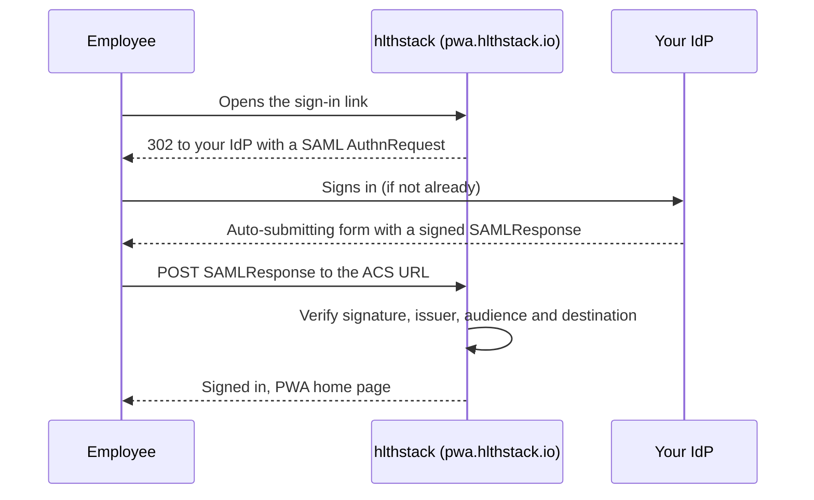

# SAML 2.0 single sign-on

Employers can sign their employees into the hlthstack PWA with their own identity provider
(IdP), such as Okta, Microsoft Entra ID (Azure AD), Google Workspace, ADFS or OneLogin.
hlthstack is the SAML 2.0 service provider (SP). Employees sign in with their work account
and land in the PWA at `pwa.hlthstack.io`; they never see an hlthstack password.

This is a different flow from the [partner SSO](../README.md) in the main guide, which is for
partners that launch the PWA from their own app with an encrypted payload. Use SAML when the
employer's IdP should decide who gets in.

## How it works

- **SP-initiated:** employees open the sign-in link (below), for example from your intranet.
  hlthstack sends them to your IdP and back.
- **IdP-initiated:** employees click the hlthstack tile in your IdP's app dashboard. The IdP
  posts straight to the ACS URL.

Both work with the same IdP configuration.

## What to configure in your IdP

hlthstack gives you a company slug for each environment. Replace `<company-slug>` below with it.
hlthstack sends you the exact URLs at onboarding; use those if they differ.

| Setting (names vary by IdP) | Production | Staging |
|---|---|---|
| SP entity ID / Audience URI / Identifier | `https://pwa.hlthstack.io/pwa` | `https://staging-pwa.hlthstack.io/pwa` |
| ACS URL / Single sign-on URL / Reply URL | `https://pwa.hlthstack.io/pwa/<company-slug>/saml` | `https://staging-pwa.hlthstack.io/pwa/<company-slug>/saml` |
| Sign-in link (SP-initiated) | `https://pwa.hlthstack.io/pwa/<company-slug>/single-sign-on` | `https://staging-pwa.hlthstack.io/pwa/<company-slug>/single-sign-on` |
| ACS binding | HTTP-POST | HTTP-POST |
| Response | Signed (sign the response, the assertion, or both) | same |
| Name ID | The employee's email address | same |
| Name ID format | Unspecified or Email address | same |

Set the entity ID and ACS URL exactly as shown: hlthstack rejects responses whose audience or
destination don't match, including a trailing slash or `http`.

### Attributes

hlthstack identifies the employee by email. It reads the email from the `emailaddress`
attribute if present, otherwise from the Name ID. To create the profile with the right name the
first time an employee signs in, also send:

| Attribute name | Value |
|---|---|
| `emailaddress` or `http://schemas.xmlsoap.org/ws/2005/05/identity/claims/emailaddress` | Work email (optional if the Name ID is the email) |
| `givenname` or `http://schemas.xmlsoap.org/ws/2005/05/identity/claims/givenname` | First name |
| `surname` or `http://schemas.xmlsoap.org/ws/2005/05/identity/claims/surname` | Last name |

Entra ID sends the `http://schemas.xmlsoap.org/...` claims by default. In Okta, add the short
names (`emailaddress`, `givenname`, `surname`) as attribute statements.

## What to send hlthstack

After you create the app in your IdP, send hlthstack, for each environment:

| Item | Where to find it |
|---|---|
| IdP entity ID / Issuer | IdP metadata `entityID`; Okta "Identity Provider Issuer"; Entra "Microsoft Entra Identifier" |
| IdP single sign-on URL | IdP metadata `SingleSignOnService` (HTTP-Redirect); Okta "Identity Provider Single Sign-On URL"; Entra "Login URL" |
| IdP signing certificate | X.509 certificate (Base64/PEM) that signs your responses |
| IdP single logout URL (optional) | IdP metadata `SingleLogoutService` |

Sending your IdP metadata XML file covers all of these. Send certificates and metadata through
the channel hlthstack gives you, not in a public ticket. When you rotate the signing
certificate, send the new one before you switch to it.

## Who can sign in

- If an employee isn't registered in hlthstack yet, hlthstack either creates their profile from the SAML attributes on first
  sign-in, or shows a "not registered" message. Which one depends on your company's setup;
  agree it with hlthstack at onboarding. To register employees in advance, use
  [pre-registration](https://github.com/hlthstack/integration-guide/blob/main/docs/pre-registration.md).
- Use your IdP's app assignment (groups or users) to control who sees and can use the app.

## Testing on staging

1. Create a separate app in your IdP using the staging values above, and send hlthstack its
   details.
2. Once hlthstack confirms it's set up, open
   `https://staging-pwa.hlthstack.io/pwa/<company-slug>/single-sign-on` in a private window.
3. Sign in at your IdP. You should land on the staging PWA home page, signed in.
4. Also try the tile in your IdP's dashboard to check IdP-initiated sign-in.

## Already using SAML on ekincare?

Your existing ekincare SAML setup keeps working; nothing changes until you choose to move. To
move to `pwa.hlthstack.io`, add a new app (or update the existing one) in your IdP with the
values above, then tell hlthstack so it can switch your company over. Plan the switch for a
quiet time: employees using the old sign-in link will need the new one.

## Troubleshooting

| What you see | Likely cause |
|---|---|
| Your IdP shows an error before sign-in, mentioning the issuer, entity ID or reply URL | The SP entity ID or ACS URL in your IdP doesn't match the table above |
| Sent back to a hlthstack error after signing in | Response not signed, signed with a certificate hlthstack doesn't have, or audience/destination mismatch |
| "Not registered" message | The employee isn't registered in hlthstack and your company is set to registered-only |
| Signed in as the wrong person, or a duplicate profile | The Name ID or `emailaddress` isn't the employee's work email |
| Works from the IdP dashboard but not from the sign-in link (or the reverse) | Your IdP app allows only one of IdP-initiated or SP-initiated sign-in |

Share the time of the attempt and the employee's email with hlthstack support.

## Not supported yet

- Signed AuthnRequests (hlthstack's requests to your IdP are unsigned).
- Single logout initiated from hlthstack for companies set up only on `pwa.hlthstack.io`.
  Signing out of the PWA ends the hlthstack session but doesn't sign the employee out of the
  IdP.
- SCIM provisioning. Use pre-registration to sync employees.
